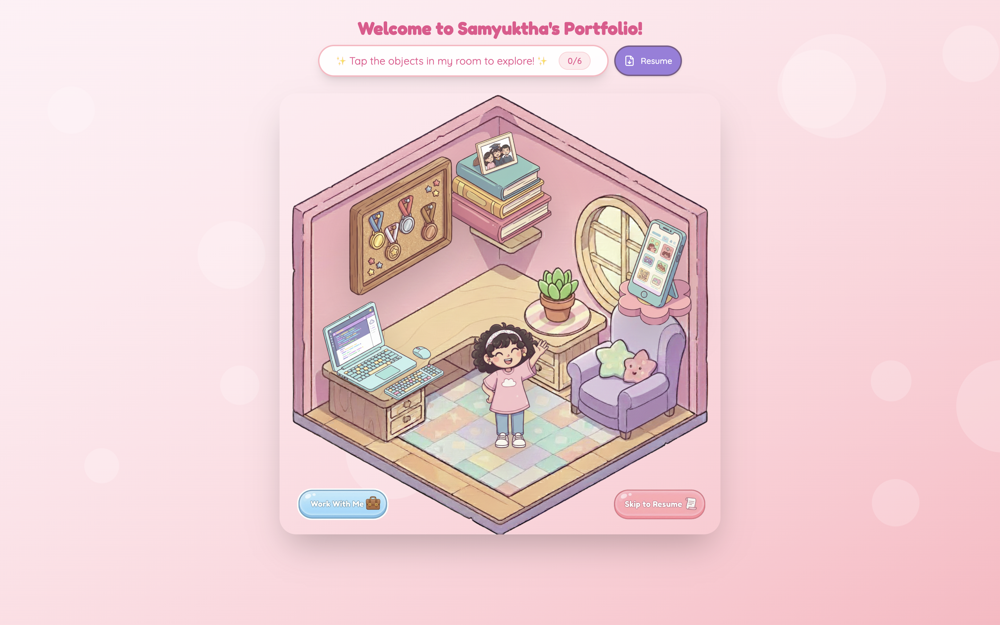
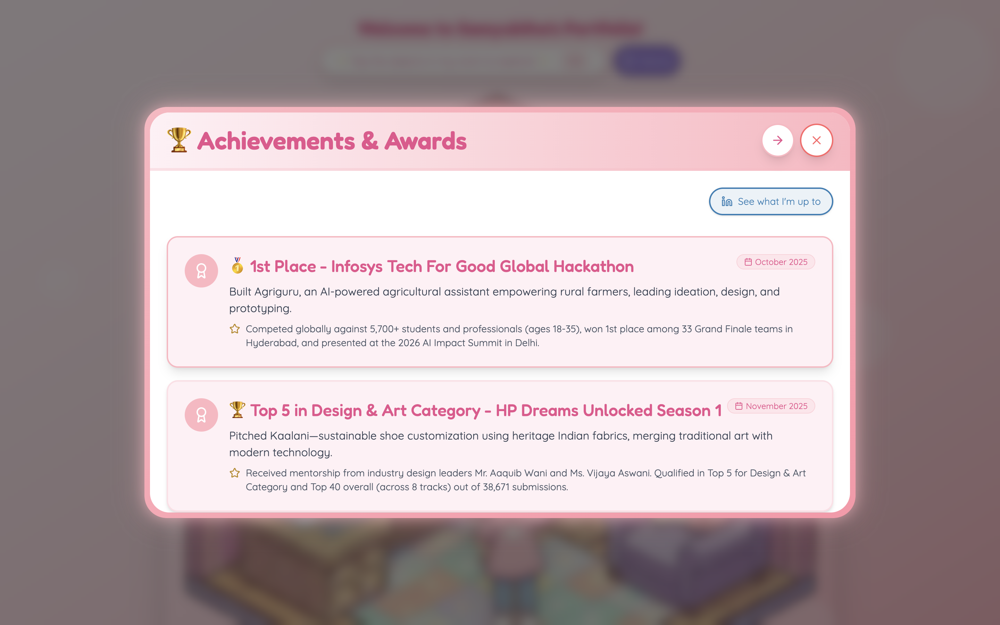
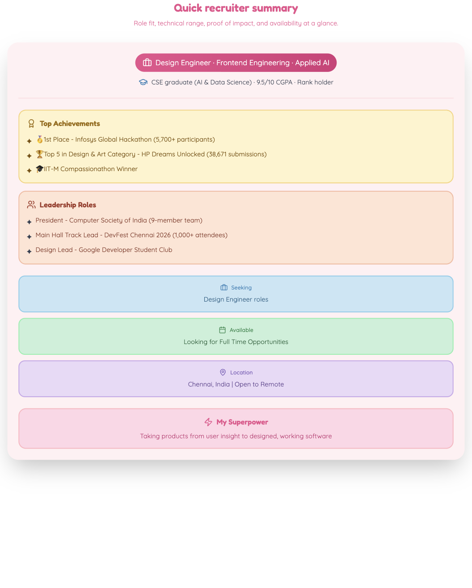
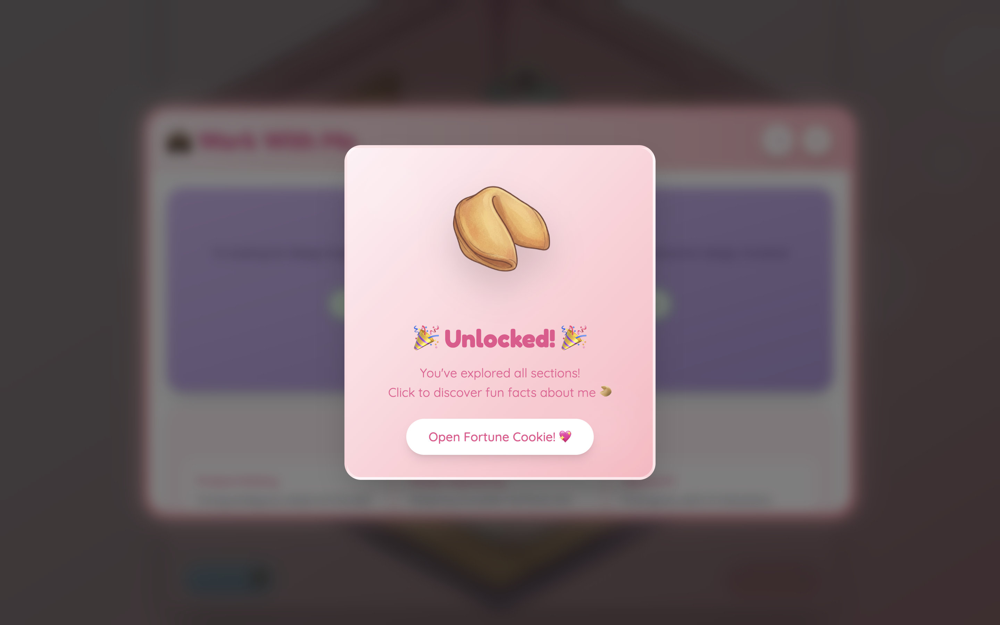

# Samyuktha's Portfolio

An interactive portfolio for Samyuktha S, a design engineer working across
frontend engineering, interaction design, and applied AI.

**Live site:** [samyuktha.figma.site](https://samyuktha.figma.site)

## What this project is

This portfolio turns the usual resume site into a small detective-room experience. 
Visitors can explore clickable objects, open project and background sections in a tablet-style interface, or skip directly to a traditional resume view.



The playful visual direction is intentional, but the content is structured for fast evaluation: role fit, selected work, outcomes, leadership experience, and contact details are all available without needing to complete the exploration.

## Highlights


### Sections

Each section is explorable from clicking an object in the room to reveal the descriptive view in a the tablet-style interface. For example, the achievements view.



### Quick recruiter summary

The summary section puts the highest-signal details first: role direction, technical range,proof of impact, leadership, and availability.



### Easter egg: Fortune cookie unlock

Exploring every section unlocks a small fortune-cookie interaction, with a few facts about me, adding a
reward without blocking the main portfolio journey.



## What's behind the site

- **React + TypeScript:** component-based UI with typed portfolio data.
- **Responsive interaction design:** separate mobile and desktop layouts,
  touch-friendly controls, and responsive project sections.
- **Accessibility-minded navigation:** semantic landmarks, labelled controls,
  skip navigation, focus trapping for the tablet dialog, and keyboard support.
- **Performance-conscious loading:** the tablet and resume/book views are lazy
  loaded with `React.lazy`, while image loading uses reusable fallback helpers.
- **Content-driven architecture:** portfolio content is centralized in
  [`src/app/data/portfolioData.ts`](src/app/data/portfolioData.ts), so content
  updates do not require editing each section.

## Run locally

```bash
pnpm install
pnpm run dev
```

Open the local URL printed by Vite (typically
[`http://localhost:5173`](http://localhost:5173)).

Create a production build with:

```bash
pnpm run build
```

## Useful navigation

- **Room:** click the illustrated objects to explore sections.
- **Resume:** use **Skip to Resume**, press `R`, or choose the resume button.
- **Tablet:** use `Arrow Left` / `Arrow Right` to change sections and `Escape`
  to close it.
- **Resume view:** use `Escape` or **Back to Home** to return to the room.
- **Resume download:** use the visible download button or `Cmd/Ctrl + P`.

## Tech stack

React 18 · TypeScript · Vite · Tailwind CSS · Motion · Lucide React · canvas-confetti

## Project map

```text
src/
├── app/
│   ├── components/       # Room, tablet, resume, and reusable UI
│   ├── constants/        # Theme tokens
│   ├── data/             # Single source of truth for portfolio content
│   ├── hooks/             # Focus and form behaviour
│   └── utils/             # Lazy-loading and resume utilities
├── assets/               # Core interface artwork
└── main.tsx              # Browser entry point
docs/screenshots/         # README screenshots captured from the running app
```

## For recruiters

Start with the [live site](https://samyuktha.figma.site), then use **Skip to
Resume** for the fastest overview. The [quick recruiter summary](docs/screenshots/quick-recruiter-summary.png)
shows role fit, proof of impact, leadership, and availability at a glance.

For source review, the most relevant files are
[`App.tsx`](src/app/App.tsx),
[`DetectiveRoom.tsx`](src/app/components/DetectiveRoom.tsx),
[`PinkTablet.tsx`](src/app/components/PinkTablet.tsx), and
[`portfolioData.ts`](src/app/data/portfolioData.ts).

## Notes

- Portfolio content and media are intentionally kept separate from UI components where possible.
- The project can run as a normal downloaded Vite repository or in Figma Make.
- The screenshots in this README are generated from the running local app.